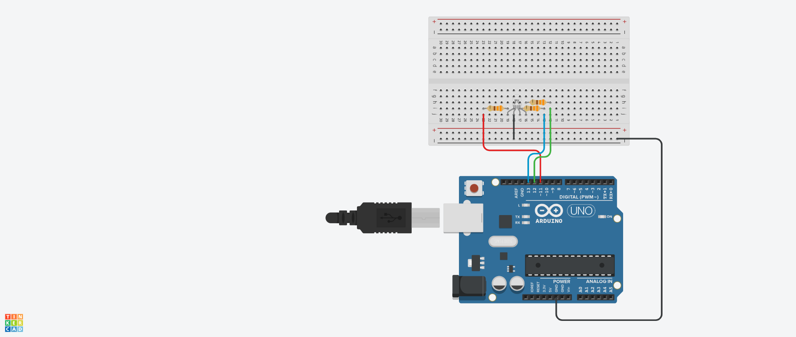

# Project: Rainbow LED (RGB Cycle)

This project introduces the use of:
* An RGB LED
* Variables (`int` and `String`) and constants
* 1D arrays 
* 2D arrays 
* Data Monitoring using the Serial Monitor.

## Circuit
**Schematic:** `rainbow_led.png`



---

## Circuit Breakdown & Components

The circuit is built using an **Arduino Uno R3**, a standard half-size breadboard, a common cathode RGB LED, and current-limiting resistors. It connects the microcontroller's digital output pins to the individual color anodes of the LED while establishing a common ground connection.

### Component List
*   **1x Arduino Uno R3** (Microcontroller board)
*   **1x Breadboard** (Half-size)
*   **1x RGB LED (Common Cathode)** 
*   **3x Resistors (330Ω)** — *Color code: Orange-Orange-Brown-Gold*
*   **4x Jumper Wires** (Red, Green, Blue, Black)

---

## Wiring & Connections

### 1. RGB LED Configuration
The RGB LED package contains three individual light-emitting diodes (Red, Green, and Blue) that share a single common ground (Cathode) leg. Looking at the breadboard layout from left to right:
*   **Pin 1 (Red Anode):** Connected via resistor to Arduino Digital Pin 11 (Red wire).
*   **Pin 2 (Common Cathode):** Connected directly to the Arduino GND pin (Black wire). *This is the longest leg of the physical components.*
*   **Pin 3 (Blue Anode):** Connected via resistor to Arduino Digital Pin 13 (Blue wire).
*   **Pin 4 (Green Anode):** Connected via resistor to Arduino Digital Pin 12 (Green wire).

### 2. Resistor Placement
*   Three **330Ω resistors** are placed inline between the Arduino signal wires and the respective color pins (Red, Blue, and Green). 
*   **Purpose:** These current-limiting resistors safely restrict the current flowing into each color node, preventing the LED from burning out while ensuring the mixed colors appear bright and vibrant.

### 3. Microcontroller Pin Mapping

| Arduino Pin | Wire Color | Resistor Value | Destination Leg | Component |
| :--- | :--- | :--- | :--- | :--- |
| **GND** | Black | None (Direct) | Pin 2 (Cathode) | Common Ground |
| **Pin 11** | Red | 330Ω | Pin 1 (Anode) | Red Channel |
| **Pin 12** | Green | 330Ω | Pin 4 (Anode) | Green Channel |
| **Pin 13** | Blue | 330Ω | Pin 3 (Anode) | Blue Channel |

---

## Circuit Working Principle
1.  **Common Cathode Design:** Because the negative cathode is tied permanently to **GND**, sending a `HIGH` signal (+5V) from any of the Arduino digital pins (11, 12, or 13) turns that specific color channel **ON**. Sending a `LOW` signal (0V) turns it **OFF**.
2.  **Color Mixing:** Colors like **Yellow** are achieved by simultaneously setting both the Red (Pin 11) and Green (Pin 12) pins to `HIGH`. Mixed colors like **Cyan** and **Magenta** follow the exact same dual-pin active state mapping as coded in the project's 2D array.

---


## Code

```cpp
// C++ code
// Arduino Rainbow LED Project

// Pin Configurations
int red = 11;
int green = 12;
int blue = 13;

// Array to store the names of the colors for Serial Monitoring
String colors[] = {"Red", "Yellow", "Green", "Cyan", "Blue", "Magenta"};

// 2D Array to store the HIGH/LOW states for each RGB color combination
const int color_states[][3] = {
  {HIGH, LOW, LOW},    // 1. Red
  {HIGH, HIGH, LOW},   // 2. Yellow (Red + Green)
  {LOW, HIGH, LOW},    // 3. Green
  {LOW, HIGH, HIGH},   // 4. Cyan (Green + Blue)
  {LOW, LOW, HIGH},    // 5. Blue
  {HIGH, LOW, HIGH}    // 6. Magenta (Red + Blue)
};

const int total_colors = 6;
const int transitionTime = 500;

void setup() {
  // Initialize Serial Monitor at 9600 baud rate
  Serial.begin(9600);
  
  // Set RGB pins as OUTPUT
  pinMode(red, OUTPUT);
  pinMode(green, OUTPUT);
  pinMode(blue, OUTPUT);
}

void loop() {
  Serial.println("Loop start!\n");
  
  // Loop through all colors defined in the 2D array
  for (int i=0; i<total_colors; ++i) {
    digitalWrite(red, color_states[i][0]);
    digitalWrite(green, color_states[i][1]);
    digitalWrite(blue, color_states[i][2]);
    
    // Print the current color name to the Serial Monitor
    Serial.println(colors[i]);

    delay(transitionTime);
  }
  
  Serial.println("\nLoop end!\n");
  delay(transitionTime);
}
```

## Result
The RGB LED smoothly transitions through six distinct colors (Red, Yellow, Green, Cyan, Blue, and Magenta) in a continuous loop every 500ms, while simultaneously printing the active color name to the Arduino Serial Monitor.

Serial Monitor output every loop:
```
Loop start!

Red
Yellow
Green
Cyan
Blue
Magenta

Loop end!
```
