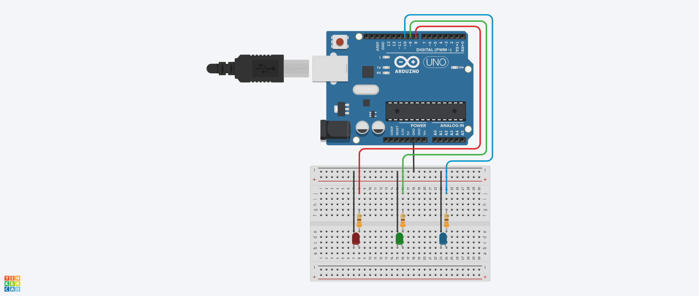

# Project: Serial Input (LED Blink Counter)

This project introduces the use of:

- **Serial Communication:** Receiving user input through the Arduino Serial Monitor.
- **Variables and Data Types:** Using `String`, `uint16_t`, and `char`.
- **User-Defined Functions:** Creating reusable functions that return values and perform specific tasks.
- **1D Arrays and 2D Arrays:** Storing LED states and mapping user selections to LED configurations.
- **Character Buffers:** Using character arrays to temporarily store formatted messages.
- **Formatted Output:** Using `snprintf()` to construct messages with variables.
- **Conditional Statements:** Using `if` statements to validate user input.
- **`while` Loops:** Waiting for serial input and controlling the number of LED blinks.
- **Serial Monitoring:** Displaying instructions, user selections, and program results.

---

## Circuit

**Schematic:** `input_blink_count.png`



---

## Circuit Breakdown & Components

The circuit is built using an **Arduino Uno R3**, a small breadboard, three individual LEDs (Red, Green, and Blue), and current-limiting resistors.

Each LED is connected to an individual Arduino digital output pin, allowing the microcontroller to control each LED independently or simultaneously.

### Component List

- **1x Arduino Uno R3** (Microcontroller board)
- **1x Small Breadboard**
- **1x Red LED**
- **1x Green LED**
- **1x Blue LED**
- **3x Resistors (330Ω)** — *Current-limiting resistors*
- **7x Jumper Wires** (Red, Green, Blue, and Black)

---

## Wiring & Connections

### 1. Individual LED Configuration

Each LED is connected to a dedicated Arduino digital output pin through a 330Ω current-limiting resistor.

The LED cathodes are connected to the Arduino's GND connection.

- **Red LED:** Connected to Arduino Digital Pin 8.
- **Green LED:** Connected to Arduino Digital Pin 9.
- **Blue LED:** Connected to Arduino Digital Pin 10.
- **Common Ground:** The cathodes of all three LEDs share the Arduino GND connection.

### 2. Resistor Placement

- Three **330Ω resistors** are connected in series with their respective LEDs.
- **Purpose:** These resistors limit the current flowing through each LED, protecting the LEDs from excessive current.

### 3. Microcontroller Pin Mapping

| Arduino Pin | Wire Color | Resistor Value | Destination | Component |
| :--- | :--- | :--- | :--- | :--- |
| **GND** | Black | None (Direct) | LED Cathodes | Common Ground |
| **Pin 8** | Red | 330Ω | Red LED Anode | Red Channel |
| **Pin 9** | Green | 330Ω | Green LED Anode | Green Channel |
| **Pin 10** | Blue | 330Ω | Blue LED Anode | Blue Channel |

---

## Circuit Working Principle

**1. Independent LED Control:** Each LED is controlled by its own digital output pin. Sending a `HIGH` signal (+5V) turns the corresponding LED **ON**, while sending a `LOW` signal (0V) turns it **OFF**.

**2. Multiple LED Configurations:** By controlling multiple digital output pins simultaneously, the Arduino can illuminate different combinations of LEDs.

**3. User-Defined LED Selection:** The user selects an LED configuration through the Serial Monitor. The Arduino retrieves the corresponding HIGH/LOW states from a 2D array and applies them to the three digital output pins.

**4. Blink Counter:** The Arduino uses a `while` loop to repeatedly turn the selected LEDs ON and OFF until the requested number of blinks has been completed.

---

## Code

```cpp
// C++ code
// Arduino Serial Input LED Blink Counter Project

// Store the user's name
String username;

// Pin Configurations
const uint8_t red = 8;
const uint8_t green = 9;
const uint8_t blue = 10;

// LED transition interval (milliseconds)
const uint16_t transitionTime = 300;


// Function to retrieve the user's LED selection
uint16_t getUserOption()
{
  Serial.println("Select which LED to blink!");
  Serial.println("1. Red");
  Serial.println("2. Green");
  Serial.println("3. Blue");
  Serial.println("4. Red & Green");
  Serial.println("5. Green & Blue");
  Serial.println("6. Blue & Red");
  Serial.println("7. All of them");
  Serial.print("Your option (1-7): ");

  // Wait until serial data is received
  while (Serial.available() == 0) {}

  uint16_t option = Serial.parseInt();
  Serial.readStringUntil('\n');

  return option;
}


// Function to retrieve the requested number of blinks
uint16_t getUserBlinkCount()
{
  Serial.print("Enter the number of times LED(s) blink: ");

  // Wait until serial data is received
  while (Serial.available() == 0) {}

  uint16_t count = Serial.parseInt();
  Serial.readStringUntil('\n');

  return count;
}


// 2D Array to store the HIGH/LOW states of each LED configuration
const uint8_t LED_states[8][3] = {
  {LOW, LOW, LOW},       // 0. All LEDs OFF
  {HIGH, LOW, LOW},      // 1. Red
  {LOW, HIGH, LOW},      // 2. Green
  {LOW, LOW, HIGH},      // 3. Blue
  {HIGH, HIGH, LOW},     // 4. Red + Green
  {LOW, HIGH, HIGH},     // 5. Green + Blue
  {HIGH, LOW, HIGH},     // 6. Blue + Red
  {HIGH, HIGH, HIGH}     // 7. All LEDs ON
};


// Function to control the LEDs based on the selected option
void blinkLED(uint16_t option)
{
  // Validate the user's selection
  if (option < 1 || option > 7) option = 0;

  digitalWrite(red, LED_states[option][0]);
  digitalWrite(green, LED_states[option][1]);
  digitalWrite(blue, LED_states[option][2]);
}


void setup()
{
  // Initialize Serial Monitor at 9600 baud rate
  Serial.begin(9600);

  // Set LED pins as OUTPUT
  pinMode(red, OUTPUT);
  pinMode(green, OUTPUT);
  pinMode(blue, OUTPUT);

  // Request the user's name
  Serial.print("Enter your name: ");

  while (Serial.available() == 0) {}

  username = Serial.readStringUntil('\n');
  username.trim();

  // Create a character buffer for the greeting message
  char msg1buffer[120];

  snprintf(
    msg1buffer,
    sizeof(msg1buffer),
    "\nHello %s, please select the blinking options and enter the number of blinks!",
    username.c_str()
  );

  Serial.println(msg1buffer);
}


void loop()
{
  // Retrieve the user's LED selection
  uint16_t user_option = getUserOption();
  Serial.println(user_option);

  // Retrieve the requested number of blinks
  uint16_t blink_count = getUserBlinkCount();

  // Create a character buffer for the blink count message
  char msg2buffer[50];

  snprintf(
    msg2buffer,
    sizeof(msg2buffer),
    "\nLED(s) will blink %u time(s).",
    (unsigned int)blink_count
  );

  Serial.println(msg2buffer);


  // Repeat until the requested number of blinks is completed
  while (blink_count > 0)
  {
    // Turn the selected LED(s) ON
    blinkLED(user_option);
    delay(transitionTime);

    // Turn all LEDs OFF
    blinkLED(0);
    delay(transitionTime);

    blink_count--;
  }

  Serial.println("Done!\n");
}
```

---

## Code Breakdown & Concepts

### 1. Serial Communication & User Input

The Arduino communicates with the computer through the Serial port.

```cpp
Serial.begin(9600);
```

Initializes serial communication at a baud rate of **9600 bits per second**.

The project uses several Serial functions:

| Function | Purpose |
| :--- | :--- |
| `Serial.print()` | Prints text without automatically moving to a new line. |
| `Serial.println()` | Prints text and moves to a new line. |
| `Serial.available()` | Returns the number of bytes available to read from the Serial buffer. |
| `Serial.parseInt()` | Reads and converts incoming numeric characters into an integer. |
| `Serial.readStringUntil('\n')` | Reads incoming characters until a newline character is encountered. |

**Waiting for User Input:**

```cpp
while (Serial.available() == 0) {}
```

The `while` loop continuously checks whether incoming serial data is available.

- If `Serial.available()` returns `0`, no data has been received, so the loop continues.
- Once data becomes available, the condition becomes false and the program proceeds.

This allows the Arduino to wait for user input before executing the next instruction.

**NOTE:** Set the Serial Monitor line ending to `Newline` so that `Serial.readStringUntil('\n')` can correctly identify the end of the input.

### 2. User-Defined Functions

The project introduces functions that separate specific tasks into reusable blocks of code.

Three functions are implemented:

| Function | Return Type | Purpose |
| :--- | :--- | :--- |
| `getUserOption()` | `uint16_t` | Retrieves the user's LED selection. |
| `getUserBlinkCount()` | `uint16_t` | Retrieves the requested number of blinks. |
| `blinkLED(uint16_t option)` | `void` | Controls the LEDs based on the selected configuration. |

**Functions with Return Values:**

```cpp
uint16_t getUserOption()
{
  uint16_t option = Serial.parseInt();
  return option;
}
```

The `uint16_t` return type indicates that the function returns an unsigned 16-bit integer.

The `return` statement sends the retrieved value back to the location where the function was called.

For example:

```cpp
uint16_t user_option = getUserOption();
```

The returned value is stored inside `user_option`.

**Functions with `void`:**

```cpp
void blinkLED(uint16_t option)
```

The `void` return type indicates that the function does not return a value.

Instead, it performs an operation—in this case, controlling the LED states.

### 3. 2D Arrays & LED State Mapping

The project uses a 2D array to store the HIGH/LOW states for different LED combinations.

```cpp
const uint8_t LED_states[8][3] = {
  {LOW, LOW, LOW},
  {HIGH, LOW, LOW},
  {LOW, HIGH, LOW},
  {LOW, LOW, HIGH},
  {HIGH, HIGH, LOW},
  {LOW, HIGH, HIGH},
  {HIGH, LOW, HIGH},
  {HIGH, HIGH, HIGH}
};
```

The array contains:

- **8 rows:** Representing LED configurations numbered 0–7.
- **3 columns:** Representing the Red, Green, and Blue LEDs.

Each row represents one possible combination of LED states.

| Option (Row) | Red | Green | Blue | LED Configuration |
| :--- | :--- | :--- | :--- | :--- |
| 0 | LOW | LOW | LOW | All OFF |
| 1 | HIGH | LOW | LOW | Red |
| 2 | LOW | HIGH | LOW | Green |
| 3 | LOW | LOW | HIGH | Blue |
| 4 | HIGH | HIGH | LOW | Red + Green |
| 5 | LOW | HIGH | HIGH | Green + Blue |
| 6 | HIGH | LOW | HIGH | Blue + Red |
| 7 | HIGH | HIGH | HIGH | All ON |

**Accessing the 2D Array:**

```cpp
LED_states[option][0]
LED_states[option][1]
LED_states[option][2]
```

The first index selects the row (LED configuration), while the second index selects the column (individual LED).

For example:

```cpp
LED_states[4][0]
```

Returns `HIGH`, because the first LED (Red) is ON in configuration 4.

The `const` keyword ensures that the stored LED configurations cannot be modified during program execution.

### 4. Character Buffers & Formatted Output

The project introduces character buffers to temporarily store formatted messages before displaying them through the Serial Monitor.

```cpp
char msg1buffer[120];
```

This declares a character array with a capacity of 120 characters.

Unlike a `String` variable, a character array stores individual characters and uses a null terminator (`\0`) to indicate the end of the string.

**Using `snprintf()`:**

```cpp
snprintf(
  msg1buffer,
  sizeof(msg1buffer),
  "\nHello %s, please select the blinking options!",
  username.c_str()
);
```

`snprintf()` formats a message and stores the resulting characters inside the specified buffer.

| Argument | Purpose |
| :--- | :--- |
| `msg1buffer` | Destination character buffer. |
| `sizeof(msg1buffer)` | Maximum buffer capacity. |
| Format string | Message template containing placeholders. |
| `username.c_str()` | String value converted into a C-style character string. |

**Common Format Specifiers:**

| Specifier | Data Type | Example |
| :--- | :--- | :--- |
| `%s` | C-style string | `"Arduino"` |
| `%d` | Signed integer | `-10` |
| `%u` | Unsigned integer | `10` |
| `%f` | Floating-point number | `3.14` |
| `%c` | Character | `'A'` |

**NOTE:** `snprintf()` is preferred over `sprintf()` because it accepts a buffer size, helping prevent writing beyond the allocated character array.

### 5. Conditional Statements & Input Validation

The `blinkLED()` function validates the user's selection before accessing the 2D array.

```cpp
if (option < 1 || option > 7) option = 0;
```

The condition checks whether the selection is outside the valid range of 1–7.

- If the selection is valid, the corresponding LED configuration is used.
- If the selection is invalid, the option is changed to `0`, which represents all LEDs being OFF.

This prevents the function from accessing an invalid row of the 2D array.

### 6. While Loops & Blink Counter

The project uses `while` loops for two different purposes.

**A. Waiting for Serial Input**

```cpp
while (Serial.available() == 0) {}
```

Waits until the user provides input through the Serial Monitor.

**B. Controlling the Number of Blinks**

```cpp
while (blink_count > 0)
{
  blinkLED(user_option);
  delay(transitionTime);

  blinkLED(0);
  delay(transitionTime);

  blink_count--;
}
```

This loop controls how many times the selected LED configuration blinks.

The execution sequence is:

1. Turn the selected LED(s) ON.
2. Wait for `transitionTime` (300ms).
3. Turn all LEDs OFF.
4. Wait another 300ms.
5. Decrease `blink_count` by 1.
6. Repeat until `blink_count` reaches 0.

**Understanding the Decrement Operator:**

```cpp
blink_count--;
```

The `--` operator decreases the variable's value by one.

For example, if the initial `blink_count` is 3:

| Iteration | Blink Count Before | Blink Count After |
| :--- | :--- | :--- |
| 1 | 3 | 2 |
| 2 | 2 | 1 |
| 3 | 1 | 0 |

Once the count reaches zero, the condition `blink_count > 0` becomes false, and the loop terminates.

---

## Result

The Arduino first requests the user's name through the Serial Monitor. After receiving the name, it displays a personalized greeting and presents seven LED selection options.

The user can select an individual LED or a combination of LEDs, followed by the desired number of blinks.

The Arduino then executes the requested blinking sequence, turning the selected LEDs ON and OFF at 300ms intervals until the requested blink count is completed.

**Example Serial Monitor Output:**

```text
Enter your name: Alex

Hello Alex, please select the blinking options and enter the number of blinks!

Select which LED to blink!
1. Red
2. Green
3. Blue
4. Red & Green
5. Green & Blue
6. Blue & Red
7. All of them
Your option (1-7): 4

Enter the number of times LED(s) blink: 3

LED(s) will blink 3 time(s).
Done!
```

**Expected LED Behaviour:**

For the example above, selecting option `4` and entering `3` results in:

1. Red and Green LEDs turn ON for 300ms.
2. All LEDs turn OFF for 300ms.
3. The sequence repeats three times.
4. The Arduino prints `Done!` after completing the sequence.

The project demonstrates how an Arduino can receive user-defined parameters through serial communication and use those parameters to control physical hardware dynamically.